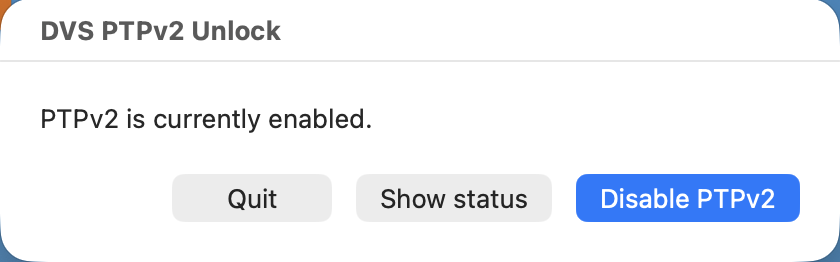
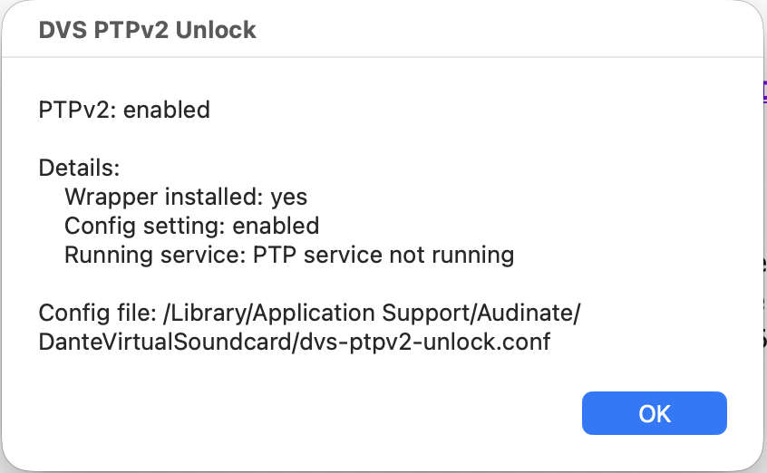

# DVS PTPv2 Unlock

Turn on PTPv2 support in the Dante Virtual Soundcard — one double-click,
on macOS and Windows.

[](../../actions/workflows/build.yml)



> **Disclaimer — community project, not supported by Audinate.**
> This is an independent, unofficial community effort. It is **not affiliated
> with, endorsed by, or supported by Audinate**, and it uses undocumented
> options of the Dante Virtual Soundcard. Do not ask Audinate support for help
> with it. Use at your own risk: it replaces a file inside the DVS installation
> and may stop working — or break DVS — with any DVS update. It may also affect
> your warranty or support entitlement. Deactivate it and restore the original
> `ptp` before contacting Audinate about any DVS issue. Dante and Dante Virtual
> Soundcard are trademarks of Audinate Pty Ltd.


## Install

Both archives on the [Releases](../../releases) page contain a prebuilt binary,
so you need no compiler and no Terminal.

**macOS** — download `dvs-ptpv2-unlock-macos.zip`, unzip, and double-click
**`DVS PTPv2 Unlock.app`**. On first launch macOS blocks unsigned apps once:
right-click the app → **Open** → **Open**.

**Windows** — download `dvs-ptpv2-unlock-windows.zip`, unzip, and double-click
**`DVS PTPv2 Unlock.cmd`**. Confirm the administrator (UAC) prompt.


## Use

One switch — **Enable PTPv2** / **Disable PTPv2** — plus **Show status**. Enter
your password once; the change is applied and the PTP service is restarted for
you, so no manual DVS restart is needed.

- **Enable** puts a small wrapper in place of DVS's `ptp` binary. The wrapper
  passes every argument DVS gives it through untouched and adds `-y2=-2`,
  mirroring the `-m1=` interface to `-m2=`. Nothing is ever removed.
- **Disable** restores DVS's original `ptp` (kept as `ptp-original`), leaving
  nothing of ours behind.

It adds no background service, changes no system settings, and touches nothing
outside the DVS application folder.

### Show status

**Show status** answers *is PTPv2 actually on right now?* — it reads the
**running** PTP process, not just the stored setting:



PTPv2 counts as enabled only when the wrapper is in place **and** the config
asks for it, so a half-finished state can never claim to be on.

> **After a DVS update:** the updater restores Audinate's `ptp` and silently
> switches PTPv2 off again. Open the panel and enable it once more —
> **Show status** tells you when this has happened.


## Troubleshooting

- **macOS still refuses to open the app** (downloaded archives carry a
  quarantine flag). Clear it once:
  ```
  xattr -dr com.apple.quarantine "DVS PTPv2 Unlock.app"
  ```
- **Windows "file in use"** — a running `.exe` cannot be replaced. The panel
  stops and restarts DVS around the swap; if it still fails, quit the Dante
  Virtual Soundcard completely and try again.
- Installations in `C:\Program Files\...` and `C:\Program Files (x86)\...` are
  both found automatically.


## Advanced

<details>
<summary><b>Config file</b></summary>

The setting lives in `dvs-ptpv2-unlock.conf` next to the DVS binary (macOS
`/Library/Application Support/Audinate/DanteVirtualSoundcard`, Windows
`C:\Program Files\Audinate\Dante Virtual Soundcard`). It is read every time DVS
starts the PTP service, so editing it by hand and restarting DVS works too. The
value accepts `1/0`, `true/false`, `yes/no`, `on/off`:

```
ptpv2 = 1
```
</details>

<details>
<summary><b>Command line (macOS, Makefile)</b></summary>

```
make build          compile the wrapper
sudo make install   back up ptp to ptp-original and install the wrapper
sudo make uninstall restore the original ptp
make status         show what is installed and configured
make clean          remove the built binary
```

`install` only creates the backup if `ptp-original` does not already exist, so
running it twice can never overwrite the real original. Edit the config file
(above) and restart DVS to switch PTPv2 on.
</details>

<details>
<summary><b>Building from source</b></summary>

**macOS** — universal binary plus the launcher app:

```
cc -arch arm64 -arch x86_64 -o dvs-ptpv2-unlock dvs-ptpv2-unlock.c && ./build-app.sh
```

`build-app.sh` bundles the control script, config and binary *inside* the app
and re-signs it (ad-hoc), which keeps it working under macOS App Translocation.

**Windows** — if you have no compiler, the
[mingw installer](https://github.com/Vuniverse0/mingwInstaller/releases/) works:

```
gcc -DWIN32 -O2 -o dvs-ptpv2-unlock.exe dvs-ptpv2-unlock.c
```

Every push is built for both platforms in CI, and the Windows job runs an
end-to-end test suite (`tests/windows-test.ps1`) that exercises the real binary
and the control-panel functions against a temporary DVS folder.

To build a wrapper that enables PTPv2 even **without** a config file, uncomment
the default at the top of `dvs-ptpv2-unlock.c`:

```
// #define DEFAULT_ENABLE_PTPV2 1
```
</details>

<details>
<summary><b>Manual installation</b></summary>

In the DVS application folder, rename the original `ptp` to `ptp-original`, put
the compiled `dvs-ptpv2-unlock` in its place as `ptp`, and drop a
`dvs-ptpv2-unlock.conf` containing `ptpv2 = 1` next to it.

On Windows the files carry an `.exe` extension (`ptp.exe`, `ptp-original.exe`)
and DVS must be stopped first — a running executable cannot be replaced.
</details>
